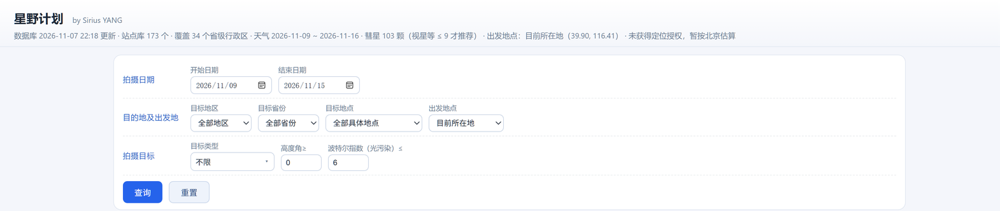

# dsh-astro-plan · 星野计划

[](https://www.npmjs.com/package/dsh-astro-plan)
[](LICENSE)
[](docs/market-index.json)

为 DeepSeek Harness 增加一个**星野摄影计划**能力：按目标类型 / 全国地点 / 时间段检索，
结合光污染（波特尔指数）、拍摄方位、月相、天象事件与 **7 天内实时天气**，
给出推荐拍摄目标、地景、相机焦段（全画幅 / APS-C）与曝光参数，并按**推荐度排序**。

- **工具**：`astro_plan`（模型可调用，返回结构化结果 + Markdown 表）
- **页面**：`http://127.0.0.1:<DSH端口>/astro-plan/`（自包含，无外部资源）
- **会话 Tab**：「星野计划」（原生 conversation.view 面板）
- **站点库**：173 个全国优质拍星点，覆盖 34 个省级行政区（默认全部参与评估）
- **目标库**：71 个目标，其中深空 47 个（星系 12 / 星云 18 / 星团 11 / 行星状星云 6）
- **彗星库**：103 颗（MPC 轨道根数，2024–2044 年最亮 ≤ 15 等，含椭圆/近抛物/双曲轨道）
- **每周自动更新数据库**：每周首次启动时后台从 MPC 重建彗星库，页面第一行小字显示数据库更新时间
- **零运行时依赖**：星历用 vendored `astronomy-engine`（MIT），天气用 Open-Meteo，极光用 NOAA SWPC Kp 预报
- **用户指南**：[docs/user-guide.md](https://github.com/beyangyi/dsh-repository/blob/main/docs/user-guide.md)（真实界面截图，覆盖全部功能）
- **一句话**：星野计划（by Sirius YANG）：按 18 类天象与深空目标、全国 173 站、最长一年检索，结合光污染、方位、月相、星历事件与 7 天天气，给出推荐排序、地景、焦段与曝光；每条结果附 Stellarium 风格 3D 天球画面模拟（真实银河等值线、真实月相、实测天际线）。



## 界面（v0.29.0）

**页面顶部：`星野计划` + 小字 `by Sirius YANG`，下面紧跟查询栏**

**查询区按行分组，每行的查询要素保持在同一行；底部「查询」「重置」**

| 行 | 字段 |
|---|---|
| 拍摄日期 | 开始日期、结束日期（**跨度最长一年**；开始日期不得晚于结束日期） |
| 目的地及出发地 | 目标地区 → 目标省份 → 目标地点（三级联动）、出发地点 |
| 拍摄目标 | 目标类型、高度角≥（**默认 0°**）、波特尔指数（光污染）≤ |

- **页面标题 / 会话 Tab / 工具标题统一叫「星野计划」**，作者小字 `by Sirius YANG` 跟在标题后
- **深色 / 浅色双主题**：默认深色；系统或外观设置切到浅色（或「跟随系统」且系统为浅色）时自动换成浅色配色。
  页面用 CSS 变量 + `prefers-color-scheme`，也可用 `?theme=light|dark` 强制；会话 Tab 直接采样宿主背景色判断，
  宿主外观一变就跟着换（`data-ap-theme`）
- **表格上方只保留两行小字**：① 页头一行（**数据库 2026-11-07 22:18 更新** · 站点库 173 个 · 覆盖 34 省 · 天气 … · 彗星 103 颗 · 出发地点 …）
  ② 统计行（`候选 N 条 · 评估站点 N 个 · 结果按推荐度排序，点击行展开详情 ｜ 查询备注`）
- **打开页面不自动检索**：先确认/调整条件再点「查询」；「重置」只恢复默认条件并清空结果，同样不自动查
- **高度角≥ 默认 0°**：地平线以上即可参与评估（0 是合法值，不会被默认值当成空值吞掉）；只想看高空目标时自己填 20/30
- **日期校验在前端可见**：开始晚于结束、或跨度超过 366 天时直接提示原因，不发检索
- **目标类型改成两级菜单**（不再用原生 `optgroup` 下拉）：
  - 一级（左列）：**不限 · 星野 · 日月 · 行星 · 深空**，鼠标悬停即切换二级；
  - 二级（右列）：该分组下的具体类型，点击选中后菜单收起，按钮显示「分组 · 类型」（如 `星野 · 银河`）；
  - 选中值仍写回隐藏字段 `#type`，`run()` 读值方式不变；点空白处或按 `Esc` 收起；
  - 会话 Tab 里是同一套结构（React 组件 `TypeMenu`），行为一致
  - 星野：银河、流星雨、**彗星**、星轨、黄道光、极光
  - 日月：日食、月食
  - 行星：**单个行星** → 冲日 → **大距** → 合
  - 深空：**全部深空**、星系、星云、星团、行星状星云（子项不带「深空·」前缀；结果表「目标类型」列仍显示「深空·星系」这类细分名）
- 行内 `display:flex; flex-wrap:nowrap` 用**内联样式**写死，各组各占一行，不会被挤成两行
- 控件宽度收敛到固定尺寸（日期 128、目标地区/省份 96、目标地点 152、出发地点 118…），整行不换行、不撑宽
- **出发地点默认「目前所在地」**：打开页面即按浏览器定位计算直线距离；定位授权失败时先复用上次定位结果（localStorage），再退化为按北京估算并在**顶部提示行**标明
- 画幅 / 赤道仪等「拍摄参数」筛选条件已移除，拍摄参数改为在结果详情里直接给出

**结果列表**

- 默认按推荐度排序：`#`、推荐度、**目标类型**、目标、拍摄地点、日期、**最佳时段（带日期）**、最高高度（共 **8 列**，已去掉「直线距离」「天气」两列，这两项信息仍保留在行内详情）
- **列宽平均分配**：除「最佳时段」按单行内容固定 220px 外，其余 7 列 `1fr` 等宽；列模板 `repeat(6,1fr) 220px 1fr`
- **「最佳时段」单行显示**：`03-10 21:53 → 03-11 06:54`，一格内看完起止（`nowrap`，不换行不截断）
- **分页显示全部结果，20 条/页**：底部「上一页 / 第 x / y 页 · 共 N 条 / 下一页」，右侧带**页码输入框 + 跳转**（回车或点「跳转」都可），序号跨页连续（第 2 页从 21 开始）
- **不再截断前 60 夜**：日期范围内的每一夜都会参与评估
- **站点默认覆盖整库（173 站）**；当「站点 × 夜数」超过约 9000 时按区域均衡抽样并在备注里说明（保证一年跨度也能在数秒内返回）
- **不用 `<table>`，改用 CSS Grid 行**：每行 `display:grid` + `grid-template-columns` 直接写在元素 `style` 上，8 个单元格各自落位，任何宿主样式都无法把内容挤到第一列
- 结果区 `min-width: 1040px`，窗口变窄时**横向滚动**，列不会被压成 0
- 点击行展开**便签风格**详情（米黄便签 + 胶带 + 轻投影），分区顺序固定为：
  **目标 → 时间与月相 → 地点 → 距离与行程 → 方位与构图 → 拍摄参数 → 天气 → 推荐度明细与推荐理由**
- 「推荐度明细与推荐理由」合并为一个区块：左侧是各维度得分条与分数，右侧是对应得分的理由文字；
  **日食只显示「天象 / 天气 / 地景」三项**（光污染与月相不参与，直接隐藏而不是给假分）；
  **月食不显示「月相」**（月球自己就是目标，月光没有意义），只显示天象 / 光污染 / 天气 / 地景；
  **行星与深空不显示「地景」**（主体优先，地景只作构图参考不给分）
- 彗星目标的详情里额外给出**视星等 / 距日角 / 距地距离 / 日心距**
- **「可见窗口」只显示月日**（`03-10 21:53 – 03-11 06:54`），和表格里的时段格式一致
- **「最高高度」带方位**：便签里写成 `61.7°（南 180°）`——取的是**高度最高那一刻**的方位名与方位角
  （上中天的目标在正南或正北，日出/日落边界上的目标才落在东/西），表格里的高度列同步用这个方向
- **Bortle 复核提示挪到「推荐度明细」里光污染那一行说明的末尾**（地点区块不再重复这句话）
- 「距离与行程」含直线距离、**估算车程**（直线 × 1.2–1.6）、出发地点（表格里不再单列，信息保留在便签里）
- **深空拍摄目标一律按赤道仪参数计算**：单张 120 s × 20 张叠加，`赤道仪：必须使用`（不再随用户是否勾选赤道仪变化）
- **单个行星 / 冲日 / 大距 只给赤道仪参数**：`1/20 s × 500 帧`视频叠加（取 10–20% 最优帧）、ISO 800、`赤道仪：必须使用`；
  行星亮度高，不给几十秒的长曝方案
- **合：两颗天体（合月时含整轮月球）必须同时入镜，焦段由角距反推**（不再沿用固定的 200–1200mm）：

  ```
  张角   = 角距 + 两侧半径（框以两颗中点为心；合月时两侧各一个月面半径 0.26°）
  需要视场 = 张角 × 1.8（构图余量）
  全画幅 f = 24 / (2·tan(视场/2))     ← 用画幅短边反解，横竖构图都塞得下
  ```

  长焦端 ≥ 400mm 且画面里没有月球时离不开赤道仪（短曝只有零点几秒，叠 20 张要靠跟踪）；
  含月球时画面最亮的是月球，曝光改按 Looney 11（毫秒级），长焦也不必上赤道仪：

  | 合 | 角距 | 张角 | 同框焦段 | 短边视场 | 赤道仪 | 曝光 |
  |---|---|---|---|---|---|---|
  | 火星合月 | 3.91° | 4.17° | 90–180mm | 7.6° | 可不用 | `1/1543 s` |
  | 木星合月 | 0.87° | 1.13° | 360–670mm | 2.1° | 可不用（曝光极短） | `1/1543 s` |
  | 金星合火星 | 0.31° | 0.31° | 1100–2000mm | 0.7° | **必须** | `5 s × 20 张` |

  便签「目标」里补一行**角距**，曝光依据写成「角距 X° + 月面 0.52° → 需 N° 视场 → 焦距范围 + 要不要赤道仪」
- **无赤道仪时按法则算曝光**：广角（中位焦距 ≤ 35mm）用 **500 法则**、长焦用更保守的 **300 法则**，
  `单张 = 法则值 ÷ 等效焦距`，APS-C 按 1.5× 裁切换算；
  一支变焦两端的安全曝光不同，所以**写成区间**（长焦端短、广角端长）：
  14–24mm 全画幅 → `20.8–35.7 s`，同一支镜头在 APS-C 上 → `13.9–23.8 s`；彗星 85–400mm → `0.8–3.5 s × 40 张`（走 300 法则）
- **500/300 法则不适用时换更合适的公式**（星点拖线只是「上限」，亮目标和会动的目标另算）：

  | 题材 | 公式 | 实测（区间形式） |
  |---|---|---|
  | 银河 / 流星 / 星轨 / 黄道光（无赤道仪，广角） | `500 ÷ 等效焦距`（长焦端 → 广角端） | 银河 `20.8–35.7 s`、流星 `25–35.7 s` |
  | 彗星（无赤道仪，长焦） | `300 ÷ 等效焦距` | `0.8–3.5 s × 40 张` |
  | 月食 / 月面 | **Looney 11**：`f/11·ISO 100 = 1/100 s` 换算，再按 `2^(13·食分^1.5)` 压暗 | `1/1543–1/2 s`（满月 → 可见最深食分） |
  | 日食 | **巴德膜 ND5 经验值**：`f/8·ISO 100 = 1/1000 s` 换算，±1 档 | `1/8000–1/2000 s` |
  | 极光 | **极光经验值**：`f/2.8·ISO 1600 = 4 s`，强 Kp 减半、弱 Kp 加倍 | `2–8 s × 30 张` |
  | 行星 / 深空 | 赤道仪（视频叠加 / 120 s 单张） | `1/20 s × 500 帧` / `120 s × 20 张` |

- **便签不再解释法则**：曝光本身已经写成 `a–b s` 的可用区间，省掉一行公式说明；
  其余题材仍给依据（月面 Looney 11、日面巴德膜、极光经验值、赤道仪单张），由规划层算好、页面只负责显示
- **光圈只显示一个 f 值**：`f/2.8`、`f/4`、`f/10`，不再出现「原生焦距 + 2× 巴洛」这类说明文字
- **便签「坐标」用经纬度表述**：`北纬 40.50° · 东经 115.83°`（南半球 / 西半球自动换「南纬 / 西经」）
- **展开/收起有过渡**：点结果行展开便签、再点收起，都是 `grid-template-rows: 0fr ↔ 1fr` + 透明度的过渡（260 ms），收起时内容保留到过渡结束再卸载，不会瞬间消失、也不会硬切行高；自包含页面与会话 Tab 两套 UI 一致
- **便签两列**：左侧 7 个便签（目标 / 时间与月相 / 地点 / 方位与构图 / 拍摄参数 / 天气 / 推荐度明细），其中**推荐度明细占两列宽**；**右侧整列只放画面模拟**。`地点` 里 `地区` 与 `省份` 合并成一行（`华北 · 北京`），`直线距离` 与 `出发地` 各占一行；**深色模式下便签也是深色**（`#1b2230` 渐变，比结果表格的 `#101828` 更偏蓝、略亮，一眼能区分），浅色模式仍是米黄纸；**画面模拟的控制按钮改用便签主题色**（`--ap-note-sec` / `--ap-note-kv-val`），深色下未选中的「地平 / 赤道 / − / ＋ / 重置」也是浅字可读，选中项仍是金色高亮
  - **画布按显示尺寸出图**：`<canvas>` 的位图尺寸跟随元素实际宽度（再乘设备像素比，上限 1680），不再固定 960×540 让 CSS 拉伸——拉伸到 1250 px 时放大倍率 1.3，浏览器会重复部分列，**平滑的渐变区会出现一条条竖纹**（180° 视场最明显）；窗口尺寸变化时重排并重画
  - **3D 天球投影（立体投影 / stereographic）**：观测点在球心，天球先投到一张与视线相切的平面上（`r = k·tan(θ/2)`），再映射到屏幕——**等角**、边缘不拉伸，整圈银河拱桥不会在画面两边被拉扁；地平线以下用「天空裁剪路径」整体裁掉，星、星座、黄道、银河、网格都只出现在地景以上
  - **地平裁剪折线按 x 排序**：极宽视场时地平线会绕过画面边缘、方位序里的 x 不再单调，自交的折线做 `clip` 蒙版会被栅格化出竖条纹；排成「x 单调的函数图」后裁剪多边形一定是简单多边形
  - **天区填满整幅画面**：视场仍是内切圆的角直径，但投影圆盘半径**固定取对角线的一半**，所以 5°–180° 每一档、画面四角都落在可投影半球内（170° 时四角 85°，180° 时正好 90°、`d = 0` 仍可投影），天空和地景一路连续到画布边缘，**不再出现圆形取景框和盘外的黑边**
  - **银河（真实等值线）**：d3-celestial `mw.json` 的 5 级亮度等值线（约 3 万点）用 Douglas–Peucker 抽稀到 0.25°（202 环、2677 点），**每条环单独做近平面裁剪（Sutherland–Hodgman）** → 一条环恰好一个闭环，再按组合并成一条 path 用 even-odd 填充：外环与内部洞一起画，**暗尘带是真正的洞**，不是画上去的深色。填充一律走**加色混合**（`lighter`），只会在底色上做加法，**任何视角下都不会比天空暗**。
    - 裁剪平面**固定在 89°**（不随视场变），所以同一片天区在任何视场、任何时刻都填同一块地方，缩放 / 拖动 / 播放都不会「换个地方亮」。
    - 裁剪点之间**沿裁剪圆插弧收口**，不会拉出横穿画面的长弦（那就是以前那条「浅色带」）。
    - 数据里的**第 0 级不填**：实测它的 even-odd 区域覆盖 89% 天空、银心反而落在外面——它是「背景」轮廓，填了就是把夜空点亮、银河带留暗，正是用户看到的「银河和夜空换色」。
    - **按真实等值线画明暗**：5 级是**嵌套的环带**（每级 = 外环 − 内洞），第 0 级是包住银河带的一圈极淡薄雾（实测覆盖 89% 天空，银心落在它的洞里），越往里越亮。逐级 alpha 为 **0.010 / 0.060 / 0.050 / 0.050 / 0.050**：核心累计 0.21、带缘 0.06、薄雾 0.01——观感上银河落在一条带上、带外只是极淡的雾。
    - 上一版曾用「把第 1 级轮廓放大 1.55× / 1.25× 各填一次」来造光晕，结果是同一图案的三份副本（用户反馈「3 个相同图案交叠」），已删除。
    - 一道**保险丝**：填充前比对「屏幕奇偶」与「球面绕数」，不一致就这一帧不画那一组——宁可少一层，也不让它反过来盖住天空。
  - **背景亮度跟着地平高度走**：天空渐变不再是钉死在屏幕上的三段色，而是按「地平 0° → 22° → 65° 天顶」铺色，拖动画面时同一块天的明暗不变；地面压暗只压地平线以下（`clipGround`），不会再顺手把天上的银河压暗
  - **真实日月大小与月相**：太阳按日地距、月球按 `GeoMoon` 地心距算视直径（约 0.49°–0.56°），放大后自然变大（默认 100° 视野下亚像素时才给 1.4 px 最小可见尺寸）；**月球按真实相位画**——明暗界限是一条真正的晨昏线椭圆（暗区面积 = 1 − 照明比例），亮面朝向太阳（屏幕方向由月球→太阳的球面切向算出），所以盈凸/弦月/娥眉的朝向都对；**暗面填的是「当处天空色」**（`skyColorAt(月球高度)`），看起来就是月亮缺了一块，而不是挖了个黑洞；**目标标记对月球只画一圈定位环**（原来会盖一枚实心白盘，把相位压成满月）；**月食按食分压暗偏红**（`item.obscuration` → 亮面混到铜红、alpha 0.95→0.55），全食时是一枚暗红圆盘
  - **地景用真实高程数据**：`tools/build-horizon.mjs` 沿每站 36 个方位、从 1.5 km 到 140 km 沿大圆采 AWS Open Data 地形瓦片（terrarium z8，约 600 m 像元），按 `atan((h − h0 − d²/2R_eff)/d)` 换算成视线仰角（含地球曲率与 0.13 折射系数），分**近景（1.5–25 km）**与**远景（25–140 km）**两层存进 `lib/data/horizon.json`（173 站 × 36 方位 ≈ 57 KB）；观测点高度取「站点实测海拔」与「瓦片读数」的高者。绘制时整圈 360 点（1°）线性插值，**山脊高度完全来自实测剖面，不再叠三角形尖**；只按地景名保留林线、水面反光、建筑块这类真实存在的细节
  - **缩放**：**滚轮与按钮都是 5°–180°**（`−` 缩小、`＋` 放大）；180° 是全天区（立体投影在 180° 的对照点是 90°，四角 `d = 0` 仍可投影）；画布按 960×540 绘制、CSS 100% 宽显示，字号/线宽随分辨率缩放；拖动灵敏度随视场自适应（`fov / 画布宽`），不再固定 0.25°/px
  - **坐标系切换**：`地平`（高度圈 30°/60°、方位线每 45°，地平线上标 **北/东/南/西**）↔ `赤道`（赤纬圈、每 2h 赤经线、天赤道虚线）；HUD 读数同步切换
  - **网格标数值**：地平网格标 `高度 30°` / `方位 45°`，赤道网格标 `赤纬 +30°` / `赤经 12h`；标注字号从 9 缩到 7（画布 960 宽时 14 px），底衬同步收窄，不再压住星点；太阳、月亮在圆盘旁标 `太阳` / `月亮`，日月食按站点实际可见情况标 `月全食/月偏食/半影月食/日全食/日环食/日偏食`
  - **HUD（带底衬，昼夜都可读）**：左上 `03-10 21:50 · 最佳时段内/时段外`；右上 `夜间/晨昏/白天 · 坐标系 · 视野`；左下 `高度角 52° · 方位角 26°`（赤道模式再加 `赤经 12h30m · 赤纬 +41°`）与站点 `北纬 40.60° · 东经 115.80°`；底部中间 `最佳时段 19:48 – 05:05`；右下 跟踪标记与缩放提示
  - **晨昏的暖亮一侧朝着太阳**：天文/民用晨昏（太阳高度 −18°～+4°）时，天空底图从「一条竖向渐变」改成 **64 条竖条**，每条的色板按 `0.5·(1+cos(方位 − 太阳方位))` 在「背阳冷色」与「朝阳暖色」之间插值——日落那一侧泛橙、对面偏冷偏暗；夜里与白天仍是原来那一条竖向渐变（不影响性能与观感）
- **默认画面**：打开就停在**最佳时段开始那一帧**（`sim.startIndex`），并按题材给初始视场——深空 40°/60°（焦距 ≥300mm 取 40°）、行星/冲日/大距 18°、合按角距与推荐焦段给 12°–70°、日月食 20°、彗星 45°、流星/星轨/黄道光 110°、银河 120°；相机取这一帧目标的方向**质心**，所以**目标正好在画面正中**（合 / 双目标取两者中点；不再像以前那样把目标抬到中心上方 22°）；播放区间是**最佳时段前后各扩 6 h**（最多 72 帧），拖进度条看整段天光变化。**「重置」回到刚打开时的画面**：默认机位 + 最佳时段开始那一帧 + 停止播放 + 地平坐标
  - **赤道仪跟踪行**：播放区有「跟踪」勾选框（默认取规划层给的 `sim.camera.tracker`）。勾上=相机跟着目标（目标恒在画面正中、地景掠过）；取消=固定机位；**手动拖拽会自动取消勾选**。缩放只改视场、不动机位，所以勾着跟踪缩小目标也不会跑掉，取消勾选缩小则保持当前方向（不再甩回默认机位）。月球只画一次（带相位、只标一个「月球」）
  - **银河 / 黄道光不画中心光晕**：这两类的「目标点」只是构图中心，原来会在取景框正中填一团径向柔光；现在只留取景框与名字（深空目标仍保留柔光标记，因为它本身就是一团光；极光没有画面模拟，页面只给说明）
- **天体图层**：632 颗亮星（星等 ≤ 4.2，含 613 个中文星名）、76 个星座连线与中文星座名（视野 < 80° 才显示名字）、黄道、水星/金星/火星/木星/土星、日月（月相）、深空/银河柔光团、取景框（`2·atan(36/2f)`×`2·atan(24/2f)`）
  - **合的初始帧 = 最佳时段开始**：不再跳到「两颗最接近」的时刻；时段开始时两颗可能已经拉开，所以视场按**该帧的实际角距**放大（`max(题材默认, 角距×2.4)`，上限 90°），取景框再按两颗的包围盒自适应，保证两颗都在画面里
- **合的取景框**：白框**以两颗天体的包围盒中心为心**（也就是相机对准的质心），尺寸取 `max(镜头视场, 包住两颗 + 各自视半径 + 20% 余量)`，两颗一定都完整落在框内；**默认帧**也改成「两颗最接近、且都在地平线上」那一刻，和拍摄参数用的是同一时刻（之前参数按事件峰值的 1°，画面里却隔着 6°）
  - **流星雨**：辐射点十字标记；每个流星雨行按站点/日期确定性生成 10–18 颗流星，沿大圆从辐射点向外飞（起始 2–15°、长度 6–25° 随流星速度缩放），持续 2–3 帧并淡出
  - **彗尾**：方向取**背日方向**（彗星日心矢量在视平面上的投影），长度 `clamp((0.06 + 0.02·max(0, 9 − V)) / Δ × 57.3°, 1.5°, 25°)`，即视星等越亮、地心距越近尾越长
  - **晨昏亮度**：逐帧按太阳高度在三套色板（夜 / 暮光 / 白天）之间插值，星点透明度随天光衰减，跨过的日落与日出会自动变亮变暗
  - **星表与银河来源**：`tools/build-sky.mjs` 从 [d3-celestial](https://github.com/ofrohn/d3-celestial)（BSD-3-Clause）取公开星表/星座连线/银河等值线，转成 `lib/data/sky.json`（J2000，运行时岁差到当天）；构建期联网一次，插件运行时不联网
  - **开关**：`withSim` 默认关闭（工具直接调用不带、结果更小），HTTP 查询默认开启，`?withSim=0` 可关；极光没有固定方位，返回 `skip: "aurora"` 并给一句说明
- 便签 `max-height: 64vh` + 内部滚动，**不会把下一行的拍摄计划挤出屏幕**；右侧模拟列 `position:sticky`，滚动左侧便签时画面不跑掉

## 安装

三种方式，任选其一（装完都要**重启 DSH 桌面应用**，宿主模块与客户端 bundle 才会重新加载）。

**1）插件市场（推荐）**：DSH 侧边栏「插件」→「发现」→ 添加索引 URL

```
https://raw.githubusercontent.com/beyangyi/dsh-repository/main/docs/market-index.json
```

列表里出现「星野计划 · Astro Plan」→ 安装。

**2）npm**：

```bash
dsh plugin --profile desktop add dsh-astro-plan@0.27.1
```

**3）本地目录（开发用）**：

```bash
dsh plugin --profile desktop add "<本目录绝对路径>"
```

验证：

```bash
curl http://127.0.0.1:<端口>/astro-plan/api/meta
```

## 发布（维护者）

发布前需要填两样东西（都不会进 git，也不会进 npm 包）：

| 填什么 | 文件 | 内容 |
|---|---|---|
| npm 令牌 | `.npmrc`（模板见 `.npmrc.example`） | `//registry.npmjs.org/:_authToken=npm_xxx`，或设 `NPM_TOKEN` 环境变量 |
| GitHub 仓库 | `market.config.json` | `owner`、`repository`（同一文件里还有分类、标签、双语文案与图标路径） |

```bash
node tools/publish.mjs --check        # 体检：令牌 / npm 账号 / 仓库地址 / 打包内容 / 索引校验
node tools/publish.mjs --publish      # 发布到 npm → 刷新索引 → 校验
git add docs/market-index.json package.json && git commit -m "market: x.y.z" && git push
```

不想用 git 也行：把 GitHub 令牌（`contents: write`）写进 `.github-token`（模板见 `.github-token.example`），然后

```bash
node tools/push-market-index.mjs --check   # 看远端有没有、内容是否一致
node tools/push-market-index.mjs           # 走 GitHub Contents API 直接推 docs/market-index.json
```

发版节奏：改 `package.json` 的 `version` → `node tools/publish.mjs --publish`（发 npm + 刷新索引）→ `node tools/push-market-index.mjs`（把索引推到 GitHub raw）
（索引里会累积每个版本的 `publishTimestamp`，市场据此判断「有新版本」）。

索引格式是 DSH 的 **format 1**：`format / title / metadata{categories,labels} / plugins[].versions[]`，
每个版本带 `source: {type:"npm"}`、`publishTimestamp`（Unix 秒）与 `engines.dsh`。
`tools/validate-market-index.mjs` 按同一套规则离线校验，生成器写完就自检，坏了不会落盘。

## 已验证（本机）

- 安装：`dsh plugin --profile desktop add <path>` → profile 依赖为 link，bundles 已包含 `dsh-astro-plan`
- 工具：`astro_plan` 已注册进模型工具列表
- 接口：`GET /astro-plan/api/meta` 200、`GET /astro-plan/` 200、`GET /astro-plan/api/night?site=haituo&date=2026-11-12` 200
- 测试：**207 项全绿**；站点库 173 站 / 34 省级行政区校验通过；深空目标 47 个；彗星库 103 颗（MPC 轨道根数，2026-11-07 快照）
- 画面模拟实测：星表 632 颗（mag ≤ 4.2，613 个中文名）、星座 76 个、黄道 72 点、银河 5 级 / 202 环 / 2677 点，
  `meta.sky` 约 71 KB；M81（450mm）→ 72 帧（最佳时段 19:48–05:05，前后各扩 6 h）、`startIndex` 指向 19:48 那帧；
  默认视场：深空 40°、行星 18°、流星 110°、银河 120°、月食 20°；海坨山（海拔 1800 m，瓦片读数 1513 m）→
  近景天际线最高 7.6°（朝主峰方向）、中位 0.1°，整圈 360 点带类型码 0–5；呼伦贝尔草原 0.3°、子梅垭口 34.4°、崂山顶 −0.8°；
  高程库 173 站 × 36 方位 × 2 层，`lib/data/horizon.json` 58 KB；20 行检索（含 sim）约 90 ms，sim 约 25 KB/行
- 投影实测（960×540）：视场 5°/40°/120°/170°/180° 的圆盘半径**恒为对角线的一半 551 px**，画面四角恰好落在 `fov/2`（170° 时 85°，180° 时 90°、`d = 0` 仍可投影）——整幅画面都是连续的天空与地景，没有圆形取景框；
  角距 θ 的落点严格等于 `k·tan(θ/2)`（θ=33° → 245.2 px，误差 < 0.7 px）
- 银河实测：银河带 1–4 级的 alpha 为 `0.12 / 0.05 / 0.03 / 0.02`（累计 0.22），最浅的第 0 级改为沿第 1 级的 **6° 宽描边**（alpha 0.04）；
  同一机位扫视场 18/60/120/180°，画面中心的填充状态**完全一致**（修复前在 150° 附近从 0% 翻到 86%，就是"最浅层和天空换色"）
- 花屏修复实测：截图那一帧（珠峰大本营 2026-11-22 07:37，fov 180°）渲染出的描边里，此前唯一 >12 px 的是柔光描边（28.8 px / 909 点）；修复后 180° 一档没有任何宽描边，60°/120° 的柔光描边线宽分别是 107 px / 50 px（随视场缩放），fov>150° 不画
- 发布链路实测：`npm pack --dry-run` 30 个文件 / 331 KB（解包 1068 KB），只含 `lib/`、`cordis.patch.yml`、`README`、`LICENSE`、`docs/icon.svg`、`package.json`；索引 `docs/market-index.json` 通过 `tools/validate-market-index.mjs`（format 1）校验，图标内联 data URL 约 2 KB
- 晨昏方向实测：太阳高度 −8°、相机朝东（太阳正东）时，天空分 64 条竖条，画面中央那条的地平色比边缘更亮更暖（`#…` 的 R 分量更大、亮度高 3 以上）；太阳 −25° 时仍是 1 条竖向渐变
- 合初始帧实测：12 组「合」检索，`sim.startIndex` 都等于 `w === 1` 的第一帧，且两颗目标的投影都落在取景框内、`camera.fov ≥ min(90, 角距×2)`
- 取景框光晕实测：`kind = milkyway / glow` 的合成 sim 渲染后，目标位置没有任何径向渐变填充，`strokeRect` 与名字仍在；`deepsky` 仍保留柔光
- 合的取景框实测：12 组「合」检索，白框全部落在画布内、两颗目标全部落在框内；参数里的角距用「可见时段最近角距」（事件峰值在白天时两者在夜里可能已拉开 6–14°），长焦端视场一律 ≥ 张角
- 银河明暗实测（青海湖黑马河 2027-07-10 22:38，对准银心）：五级环带各一笔加色填充，alpha `0.010 / 0.060 / 0.050 / 0.050 / 0.050`；32×18 网格上累计 alpha 核心 **0.21**、带缘 0.06、中位 **0.01**（大部分天空只是薄雾）；fov 60/120/180 下「银河带像素」（累计 >0.1）占比 14% / 6% / 4%，与实拍的「一条亮带 + 大片极淡薄雾」一致；屏幕填充与球面真值在 24×14 网格上一致率 100%（不一致 >2% 即判为翻面/错位）
- 花屏（视场 180°）实测：画布位图 960 px 被 CSS 拉到约 1250 px（1.31 倍）后，平滑渐变区出现周期约 4 px 的竖纹（1/0.31 ≈ 3.2 个位图像素重复一次）；改成按显示尺寸出图后不再有放大，条纹消失。另把地平裁剪折线按 x 排序（原来在 180° 时有 1 次 x 回退，clip 多边形自交）
- 月相实测：合月（月球照明 55.9%）在月球位置只剩「亮面 + 0.35 描边 + 定位环」，暗区面积 46%（理论 44%），**没有实心白盘**；月偏食（食分 0.81）月球填充为 `#be735f` / alpha 0.63
- 月球/木星去重实测：对准月球（海坨山 · 2026-11-25，月球 alt 12.6°/az 65.6°）渲染后「月球」文字**恰好 1 次**（修复前 bodies + f.moon 各画一次）；
  行星目标的「木星」也只标一次（目标标记 + bodies 各画一次的问题已修）；月食作为目标时同样 1 次，且保留相位阴影
- 月相实测：照明 100/75/50/25/5% 时暗区面积占比 0/25/50/75/95%（与 `1 − 照明比例` 一致），太阳在东/西侧时暗区方向相差约 180°
- 目标居中实测：12 种题材（深空/银河/流星/彗星/行星/冲日/大距/合/日食/月食/星轨/黄道光）默认帧里目标（多目标取质心）投影后距画面中心均 **< 6 px**（相机角度存 0.1° 的取整误差）；
  **缩放不跳**：缩放只改视场、不动 `free`，勾着跟踪时目标在任意视场都居中，取消跟踪时保持当前方向
- 背景亮度实测（海坨山 · 深空帧 · 960×540）：同一帧 free 相机 pitch 15° → 画面底端 `#0e1626`（地平辉光，亮度 21.5），
  pitch 70° → 底端 `#050a13`（亮度 9.6）、顶端恒为天顶色 `#04070f`——**明暗跟着地平高度走，不再钉死在屏幕上**；
  银河用 `lighter` 填充（`fill` 的混合模式实测为 additive），地面压暗只作用于地平线以下（`clipGround`）
- 日月视直径实测：2027-03-10 → 月球 0.515°、太阳 0.537°（随距离变化，0.49°–0.56°）
- 流星实测：双子座流星雨 · 海坨山 2026-12-14 → 辐射点 RA 112.49°/Dec 31.94°，39 条流星线段分布在 27/47 帧，
  每条线段的终点都比起点离辐射点更远（向外飞）；彗星 22P/科普夫（2028-05-23，5.1 等）→ 尾长 15.4°、尾尖比彗头更远离太阳
- 拍摄参数实测（区间形式）：银河 `20.8–35.7 s`（14–24mm，500 法则）、流星 `25–35.7 s`（14–20mm，500 法则）、
  星轨 `14.3–31.3 s × 120 张`（500 法则）、彗星 `0.8–3.5 s × 40 张`（85–400mm，回到 300 法则）、银河 APS-C `13.9–23.8 s`；
  月食按 Looney 11 → `1/1543–1/2 s`（满月 → 可见最深食分）；日食 `1/8000–1/2000 s`；极光 `2–8 s × 30 张`；
  单个行星/冲日/大距 → `1/20 s × 500 帧`、ISO 800、赤道仪必须；深空 `120 s × 20 张`；
  法则类题材不再输出公式说明（`params.hint` 为空）
- 合实测（焦段按「角距 + 月面半径」反推）：火星合月 3.91° → 张角 4.17° → `90–180mm` 可不用赤道仪；
  木星合月 0.87° → 张角 1.13° → `360–670mm`（短边视场 2.1° 装得下整轮月球），按 Looney 11 曝光 `1/1543 s` 所以也不用跟踪；
  金星合火星 0.31° → `1100–2000mm` + `5 s × 20 张` 必须跟踪
- 数据库周更实测：2026-11-07 强制刷新 → MPC 返回 622 条轨道、保留 103 颗、耗时 3.3 s；
  `comets.json.updatedAt = 2026-11-07T14:18:25.651Z`，页面第一行小字显示「数据库 2026-11-07 22:18 更新」；
  断网/失败时保留旧快照并把原因写进 `db-stamp.json`（`tests/database.test.js` 覆盖成功、跳过、失败、冷却四条路径）
- 分页实测：默认查询「第 1 / 4 页 · 共 63 条」，第 2 页序号从 21 起
- 站点覆盖实测：默认 7 夜查询「评估站点 173 个」（整库）
- 一年跨度实测：2027-01-01 ~ 2027-12-31 约 8.8 s 返回（站点按区域均衡抽样 24 个，提示条说明）
- 日期校验实测：开始 2027-03-10 / 结束 2027-03-01 → 直接提示「开始日期晚于结束日期，无法搜索」
- 极光实测：Kp 不足或超出 NOAA 预报窗口时返回原因（`no_visible` / `no_kp`），不再固定 3 条假结果
- 距离实测：北京（39.90, 116.41）→ 海坨山 93 km；→ 小五台山 124 km；→ 羊卓雍错 2639 km
- 亮度评分实测：冲日事件分 木星 95 > 火星 90 > 土星 84 > 天王星 64 > 海王星 56；
  合事件分 木星合月 90、木星合火星 89、火星合月 83；大距 水星东大距 79 / 西大距 77
- 彗星实测：2028-05-20 ~ 06-10 命中 340 条（22P 科普夫 4.9–5.1 等，2026-11-07 MPC 快照）；2026-11 ~ 2027-02 无 ≤8 等彗星，
  返回「区间内最亮的是 2P/恩克彗星（约 10.6 等）」的说明而不是空结果
- 大距实测：水星东大距 2026-10-12 有 4 站可见（华南/海南）、西大距 2026-11-21 有 67 站可见，窗口都落在晨昏
- 页面实测：`tests/webui.test.js` 用最小 DOM 真跑页面脚本，核对八列平均分配、页码输入框 + 跳转按钮、
  提示小字在「点击行展开详情」下一行且在表格之前

> 会话 Tab 若未出现，刷新一次页面；仍不出现则重启 DSH 桌面应用（客户端 bundle 需要重新加载）。

## 用法（对话里）

```
帮我找下周三全国最适合拍流星雨的地方
海坨山 11/12 这一夜怎么安排
11 月还有哪些深空目标可拍，要 Bortle 3 以内
木星合火星那天去哪儿拍、用什么焦段
2027-02-11 木星冲日去哪儿拍
```

工具参数（`astro_plan`）：

| 参数 | 说明 |
|---|---|
| `action` | `search`（默认）/ `window`（单站单夜时间轴）/ `meta` / `events` / `params` |
| `eventType` | `meteor` `comet` `solarEclipse` `lunarEclipse` `opposition` `elongation` `conjunction` `milkyway` `deepsky` `deepskyGalaxy` `deepskyNebula` `deepskyCluster` `deepskyPlanetary` `startrail` `zodiacal` `aurora` `any` |
| `location` | 站点名/id、城市、省份、区域、`"lat,lon"`、`全国` |
| `region` / `province` | 区域（华北/东北/西北/西南/华东/华中/华南/港澳台）或省份 |
| `dateStart` / `dateEnd` | 夜的定义：当日 15:00 → 次日 09:00（UTC+8）；默认今天 → +6；跨度最长一年，开始不得晚于结束 |
| `minAltitude` / `maxBortle` | 最低高度角（**默认 0**，地平线以上即可）/ 光污染上限（默认 6） |
| `page` / `pageSize` | 页码（默认 1）/ 每页条数（默认 20，上限 100） |
| `siteLimit` | 参与评估站点上限（默认=整库 128，可调小加速） |
| `format` / `tracker` | `ff`/`aps-c`；是否有赤道仪（工具参数仍支持，页面已不提供筛选） |

## 评分模型（v0.29.0）

| 维度 | 权重 | 说明 |
|---|---|---|
| 天象 | **0.40** | 可见性与天象合并：可观测时长 + 目标高度 + 事件强度 |
| 光污染 | 0.10 | **Bortle 越低分越高**：`100 − 10×(B−1)`，B1 = 100、B5 = 60、B9 = 20 |
| 月相 | 0.10 | 深空/银河严格，极光/星轨反向；**日食、月食不参与** |
| 天气 | 0.20 | Open-Meteo 逐时（夜间 19:00–05:00；日食按当地食甚时段）≤7 天 |
| 地景 | 0.20 | **不可替代性越高分越高**：方位吻合度 ×（0.55 + 0.45 × 不可替代性）；**行星、深空不参与** |

**缺维度也算百分制**：任一维度「无数据」（如超出 7 天没有天气）或「不纳入评分」时，
总分按**剩下的维度权重重新归一**：

```
总分 = Σ(参与维度权重 × 该维度得分) / Σ(参与维度权重)
```

所以「只有天象 + 光污染 + 月相」和「五个维度齐全」都是可比的 0–100 分，不会因为缺项被压成 60 分。
便签标题会标出实际参与维度数（如「按 3 个维度换算为百分制」），`breakdown.participating` 字段可直接读。

**光污染**：只反映「站点天空有多暗」，与目标要求无关（目标最低 Bortle 只写进理由里提示够不够用）。
每暗一档 +10 分，单调、可解释，不会出现「B2 和 B4 都是 100 分」的压平现象。

**地景不可替代性** = 稀缺度 × 专用度：
- **稀缺度**：同一地景名在 173 站里出现得越少越高（独占机位 1.0；「高山草甸」这种 8 站共用的「共用」只有 0.3 左右）；
- **专用度**：地景的方位窗口越窄越高（窄窗口 = 为某个方向量身定做的机位，宽 360° 的「任意低地平线」几乎不值钱）；
- **方位吻合度**：目标方位落在窗口内 0.8–1.0（越靠中心越高），出窗口后 75° 内线性衰减到 0。

所以「慕士塔格峰（全国 1 站、方位吻合 98%）」能拿到约 88 分，而通用的「开阔地平线」即便正对目标也只有 60 分上下；
没有预设地景的站点固定 30 分。便签「方位与构图」里会直接标出「不可替代性 高/中/低（全国 N 站）」。

**行星 / 深空不评地景**：这两类是「目标主体优先」的题材（长焦拍细节/深空目标本身），
构图以目标为主，机位地景只作为参考信息展示，不参与打分，权重按上表规则重新归一。

**日食例外**：日食是白天事件，**光污染与月相不参与评分**（既不给满分充数，也不占权重），
按「天象 0.4 + 天气 0.2 + 地景 0.2」在 0.8 上归一到 0–100；详情便签只显示这三项。

**月食例外**：月球自己就是目标，**月相不参与评分**，按「天象 0.4 + 光污染 0.1 + 天气 0.2 + 地景 0.2」在 0.9 上归一；
便签只显示天象 / 光污染 / 天气 / 地景四项。

**天象分细则**
- **流星雨**：ZHR 越大分越高（120 打满），距极大值每远一天 −4 分；
  列表排序：先按 ZHR 从大到小，再按「离极大的夜晚最近」，最后按站点质量
- **日食 / 月食**：先按**全食（total/annular）> 偏食**分层，再用食分细化 ——
  全食保底 85 分，偏食最高 85 分，因此同等条件下**全食永远高于偏食**；
  半影月食按弱事件当量 0.15；站点只能看到部分阶段时按可见比例轻微折算（×0.8–1.0）
- **冲日 / 大距 / 合 / 彗星**：**天体越亮分越高**
  - 冲日：`55 + 45 × clamp((8 − 视星等)/12)`，木星（−2.6 等）≈95，海王星（7.9 等）≈56
  - 大距：`45 + 30 × 亮度 + 25 × clamp(距日角/45°)`，金星大距接近满分，水星 20° 左右约 78
  - 合：`45 + 30 × 亮者亮度 + 25 × clamp((5° − 角距)/5°)`，越亮、角距越近越高分
  - 彗星：`35 + 40 × clamp((9.5 − 视星等)/9.5) + 25 × clamp((距日角 − 10°)/90°)`
    —— **越亮分越高，离太阳越远（距日角越大）也越高**
- **其他天象**：整夜可观测时间越长分越高（8 h 为满分基准）；**星轨例外**，只看目标高度不看时长

日期超过 7 天时自动剔除天气项并重归一，结果标注「仅按天文条件评估」。

## 数据库与自动更新

插件内置两类数据，更新方式不同：

| 数据 | 来源 | 更新方式 |
|---|---|---|
| 站点库 173 站 / 目标库 71 个 / 流星雨与季节表 / 参数规则 | 随插件发布（`lib/data/*.json`） | 升级插件即更新 |
| 彗星库 103 颗（轨道根数 + H/G 亮度） | MPC `CometEls.txt` | **每周首次启动自动重建** |

**周更机制**（`lib/database.js`）：

- **触发**：插件启动、`webServer` 就绪后检查 `lib/data/db-stamp.json`；距上次成功 ≥ 7 天才重建，
  否则什么也不做（纯工具调用场景不会为此联网；`apply(ctx, { autoUpdate: false })` 可整体关闭）
- **不阻塞**：`refreshIfDue()` 立即返回，抓取与筛选在后台跑（每 25 颗让出一次事件循环，HTTP 照常响应）；
  抓取 20 s 超时，失败只把原因写进 `db-stamp.json` 的 `lastError`，**旧快照原样保留**，页面照常可用
- **失败重试**：失败后 6 小时冷却，离线时不会每次启动都打网络
- **立即生效**：写盘成功后就地热替换内存里的彗星表（`reloadComets()`），不必重启应用
- **时间戳**：`lib/data/comets.json` 里的 `updatedAt` 精确到秒，页面第一行小字显示北京时间（如 `数据库 2026-11-07 22:18 更新`）；
  数据文件只有日期（`fetched`）时按日期显示
- **实测**：MPC 当前返回 622 条轨道 → 保留 103 颗，抓取 + 筛选 + 写盘 3.3 s
- **手工重建**：`node tools/build-comets.mjs`（与自动更新同一套解析/筛选代码，产物一致）

## 彗星（v0.8 扩充到 103 颗）

- **数据来源**：MPC（Minor Planet Center）`CometEls.txt` 的真实轨道根数与 H/G 亮度参数，
  由 `tools/build-comets.mjs` 抓取并筛出「2024–2044 年间最亮 ≤ 15 等」的彗星，
  落到 `lib/data/comets.json`（**103 颗**：肉眼级 7 颗、6–9 等 6 颗、9–10 等 10 颗、10–12 等 15 颗、12–15 等 65 颗，
  含椭圆 / 近抛物 / 双曲三种轨道）。**随时可重建**：`node tools/build-comets.mjs`，
  运行时每周首次启动也会自动重建（见上节「数据库与自动更新」）
- **候选池与整库分离**：检索时只把「最亮 ≤ 10 等」的 23 颗放进候选池（阈值 9 等 + 1 等余量），
  其余彗星留在库里备查/留待亮度预报更新——否则每次查询都要为几十颗永远是 13 等的彗星算一遍星历
- **为什么不用 JPL SBDB 的 M1/K1**：对 46P、103P、C/2023 A3 等著名彗星拟合偏差达 3–7 等，会漏掉真正的亮彗星；
  MPC 的 H/G 与历史极大亮度对得上（`tests/comets.test.js` 用 21P 2018 年回归标定：模型 6.4 等 / 实测算 6.5 等，Δ 0.28 AU）
- **传播**：二体开普勒（椭圆用牛顿迭代、抛物线用 Barker 方程、双曲用 sinh 解），
  含光行时改正；**不含行星摄动与非引力项**，离轨道历元越远误差越大，规划用途足够
- **亮度**：`m = H + 5·log10(Δ) + 2.5·G·log10(r)`
- **检索口径**：只推荐 **视星等 ≤ 9** 且 **距日角 ≥ 10°** 的彗星（贴着太阳的彗星会被眩光淹没），
  再用夜间的 30 分钟网格算可见窗口、高度、方位。没有候选时返回「区间内最亮的是 X（约 N 等）」，
  让用户知道是「彗星不够亮」而不是「插件坏了」
- **性能**：亮度/距日闸门用「当地 22:00」这个站点无关的时刻算，同一夜所有站点共用一次星历（缓存命中）
- **评分**：越亮、离太阳越远分越高（见上「天象分细则」里的彗星公式）
- **诚实边界**：轨道根数会随新观测更新，出发前请用最新观测复核（详情便签里已写明）

**跨天气边界的区间**：查询区间同时包含「7 天内」与「更远」的日期时，只有**预报窗口内**的日期会淘汰没取到天气的站点；
窗口外的日期一律按纯天文条件参与排序。早期版本只要有任意一天取到天气，就把整段窗口外的日期裁掉，
导致「查 2026-11-07 ~ 2027-02-01 的流星雨只剩狮子座」这种结果——已修复。

**去重与地点多样性**：
- **同一站 × 同一目标只保留得分最高的那一条**（同一场流星雨的多个夜晚不会重复占位）；
- 查询指定天象类型时不做目标配额，一次列出该类型的最佳若干**不同站点**；
- 「不限」类型时每个目标最多 3 条，避免被一场流星雨包场。

**流星雨口径**：只在**极大值前后 7 天内**、且该流星雨 **ZHR ≥ 10** 时才作为可拍目标出现在结果里；
ZHR < 10 的弱场次（如南北金牛 ZHR 5）任何日期都不上榜。极大值按「同一月日 + 时刻」平移到查询年份，
所以 2028、2029 年的英仙/双子同样可用；超出窗口的日期直接返回「不在极大值 ±7 天内」的说明。

## 天象事件（全部星历现算）

`lib/events.js` 用 vendored astronomy-engine 实时计算，**不再手抄事件表**：

- **日食**：`SearchGlobalSolarEclipse` 找全球事件，`SearchLocalSolarEclipse` 判本站可见性/食分/初亏复圆；白天事件走独立检索路径（夜间网格里太阳永远在地平线下）。**不在全（环）食带内的站点一律标为「日偏食（食分 x%）」**
- **月食**：`SearchLunarEclipse`，按峰值时刻归属到「夜」，并要求月球在地平线上；**只看到部分阶段（月出/月落打断）的站点降级为「月偏食（食分 x%）」或「半影月食（仅见部分阶段）」**。食相窗口按绝对时间算，十几分钟的短半影食也不会被网格量化丢掉
- **流星雨**：极大值取自 `events.json`（逐年平移），只在 ±7 天、ZHR ≥ 10 时参与评分
- **冲日**：`SearchRelativeLongitude(body, 0)`（0 表示冲日，180 是上合）
- **合**：两行星黄经差过零点（12h 采样 + 二分收敛），输出角距，命名以亮星为先；
  **行星合月**用同样方法（月球黄经追上行星，6h 采样，角距 ≤ 5° 才算），输出「木星合月」这类事件
- **大距**：`SearchMaxElongation`（水星/金星），只在民用暮光（太阳 −6°）的网格里找可见窗口
- **冲日 / 大距 / 合 的日期归属**：按事件在北京时间的**日历日期**归属，因此「2027-02-11 木星冲日」用 2027-02-11 查得到，
  也不会在前后夜重复刷屏
- **黄道光**：春季（黄昏西）/ 秋季（黎明东）两个窗口，按月份筛
- **极光**：`aurora` 标签的 8 个高纬站点 + 地磁纬度阈值 + NOAA Kp 预报，Kp 不足或预报未覆盖 → 不出结果
  （「不限」类型不含极光，避免没有 Kp 判据的假结果）

没有事件时直接返回 `no_event` 并提示下一次事件，**不会出现「没有月食也能查到月食」**。

## 数据与精度

- 星历：`astronomy-engine` v2.1.19（MIT）。与 astropy 对照：太阳/行星 ≤0.05°、月球 ≤0.4°、
  暮光/月升落 ≤2 min、月照度 ≤2%（见 `tests/astro.test.js`）。
- 站点：人工整理，坐标取地标/山峰/湖岸，精度 0.01–0.05°；Bortle 为**估算值**（B1 ×13、B2 ×30、B3 ×61、B4 ×52、B5 ×14、B6 ×3）。
  **核实说明**：lightpollutionmap.info 没有公开数据接口（已实测其 identify/api 端点均 404），无法自动抓取，
  因此本项目做的是「一致性审计」：把站点备注里的光害方向、与最近城市距离、区域暗夜水平与 Bortle 交叉核对，
  未发现明显矛盾（3 条备注提到"光害需避让"的站点均为 B3，与单侧光穹一致）。
  出发前仍建议在 lightpollutionmap.info 按站点坐标复核——结果详情的「地点」里直接给了坐标与提示。
- 天气：模式预报，非实况，**出发前 6 小时请复查**。
- 极光：按 NOAA SWPC 的 3 小时 Kp 预报 + 站点地磁纬度判定（地磁北极 80.65°N/72.68°W 偶极近似）。
  漠河地磁纬度约 43.9°，需 Kp ≥ 7.5；长白山约 33°，需 Kp ≥ 9。**Kp 不够就不出结果**，
  超出预报窗口的日期只给「无法判断」的说明，不会给假结果。

## 开发

```bash
node --test --test-isolation=none "tests/*.test.js"   # 176 项测试
node scripts/validate-sites.mjs --verbose             # 站点库校验（≥90 站 / ≥30 省 / 坐标包围盒）
node tools/build-comets.mjs                           # 重建彗星库（需联网，从 MPC 拉轨道根数）
node tools/build-sky.mjs                              # 重建亮星/星座表（需联网，从 d3-celestial 拉公开星表）
node tools/sync-sky-renderer.mjs                      # 改完 lib/skyview.js 的 RENDER_SRC 后同步到会话 Tab
```

> 沙箱环境里 `node --test` 默认会为每个测试文件 spawn 子进程并被拒绝（EPERM），
> 用 `--test-isolation=none` 在单进程内跑；普通环境两条命令都可以。

## 目录

```
lib/index.js        宿主入口：注册 astro_plan 工具 + 挂载 /astro-plan 路由
lib/astro.js        星历适配层（高度方位/升落/暮光/月相，含岁差与时角快速算法）
lib/events.js       天象事件现算（日食/月食/冲日/大距/合·合月 + 站级可见性 + 行星视星等）
lib/database.js     数据库维护（MPC 彗星库每周首次启动自动重建）
lib/comets.js       彗星星历层（MPC 轨道根数 → 二体传播 + 亮度模型 + 地平坐标）
lib/aurora.js       极光可见性（地磁纬度 + NOAA Kp 预报）
lib/catalog.js      站点/目标/事件/参数数据加载与地点解析
lib/scene.js        地景建模（名称→剪影高度、确定性起伏）
lib/skyview.js      画面模拟：星表岁差、meta.sky（星表/星座/黄道/银河）、sim v3（行星/日月视直径/流星/彗尾）、3D 渲染器源码
lib/weather.js      Open-Meteo 抓取 + 夜间/日间评分 + 10 分钟缓存
lib/planner.js      检索 → 可见窗口 → 五维评分 → 排序 → 分页 / 时间轴
lib/api.js          HTTP API
lib/webui.js        自包含页面
lib/client.js       原生 Tab（loader 线格式，纯 JS，零构建）
lib/data/           站点库 / 目标库 / 流星雨与季节表 / 参数规则 / 彗星轨道根数 / 地景剪影规则 / 亮星·星座·银河 sky.json + db-stamp.json
scripts/            站点库校验
tools/              彗星库与星表重建、离线预览页生成、渲染器同步
tests/              176 项测试
```

## 许可

插件代码 MIT。`lib/vendor/astronomy-engine.js` 来自
[cosinekitty/astronomy](https://github.com/cosinekitty/astronomy)，MIT License，
版权归 Don Cross。

`lib/data/sky.json` 由 [d3-celestial](https://github.com/ofrohn/d3-celestial)（BSD-3-Clause，
Copyright (c) Olaf Frohn）的公开星表裁剪生成，详见 `lib/data/NOTICE.md`。
